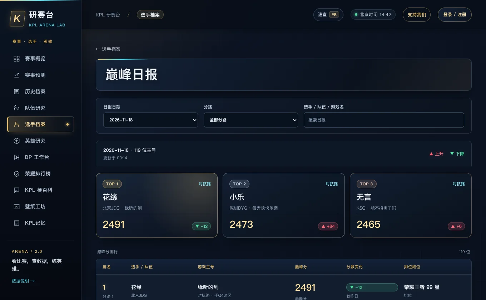

# KPL 研赛台

[打开 KPL 研赛台 →](https://kpl.new.tg/)

我们是两个喜欢看 KPL 的朋友。赛前爱猜比分，赛后想查选手最近的巅峰分，有时还想翻出第一次去现场拍的照片。研赛台就是为这些事做的小站，手机和电脑都能用。

## 可以怎么玩

- **赛前猜胜负**　把你的胜方和比分预测存下来，等赛果出来，看看自己和其他观众谁猜得准。[赛事预测](https://kpl.new.tg/#prediction)
- **追选手的巅峰分**　按日期看选手排名和分数涨跌，也可以只看自己主队或某条分路。[巅峰日报](https://kpl.new.tg/#players/report)
- **试一把模拟 BP**　选英雄、禁英雄，自己当一次教练，看看两边最后能凑出什么阵容。[BP 工作台](https://kpl.new.tg/#bp)
- **收藏自己的观赛记忆**　在地图上找到比赛，把现场照片、视频和当时想说的话存到那一场。可以公开分享，也可以只留给自己。[KPL 记忆](https://kpl.new.tg/#memories)
- **把喜欢的选手放进锁屏**　挑几张签名和素材，自己排位置，拼一张壁纸。[壁纸工坊](https://kpl.new.tg/#wallpapers)
- **补补弹幕里的梗**　翻一翻常见说法的来历，下次看到弹幕就能接上了。[KPL 梗百科](https://kpl.new.tg/#memes)

## 巅峰日报

## KPL 记忆里的赛场地图

要是这个小站刚好对你有用，欢迎点一下仓库右上角的 **Star**。下次想看比赛，回来点顶部的网站链接就行。
