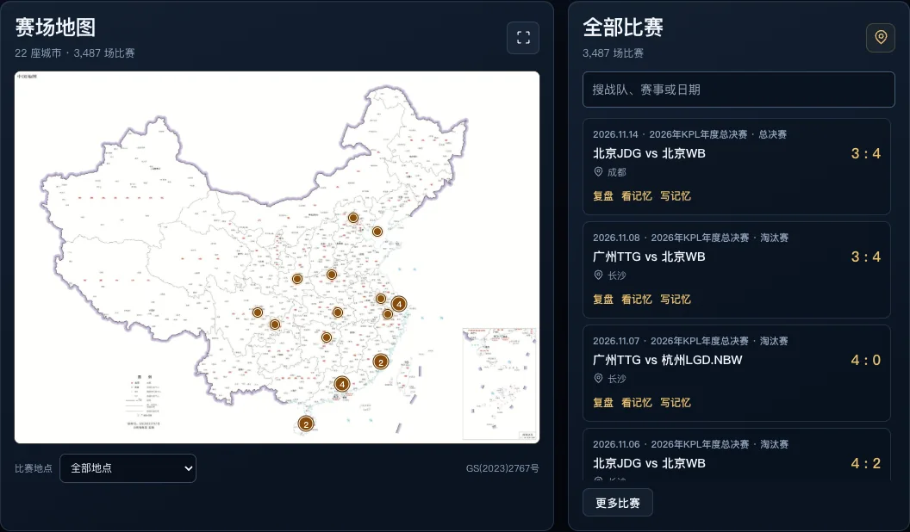

# KPL 研赛台

KPL 研赛台是面向王者荣耀职业联赛（KPL）观众的赛事资料与观赛工具平台。平台按比赛、战队和选手整理赛事记录，并提供赛前预测、英雄禁选模拟和个人观赛档案。

**网站入口**　[https://kpl.new.tg/](https://kpl.new.tg/)

## 赛事与选手数据

| 模块 | 功能 |
| --- | --- |
| [历史档案](https://kpl.new.tg/#archive) | 按年份、赛事或战队检索比赛，查看系列赛比分和单局双方阵容。 |
| [战队研究](https://kpl.new.tg/#teams)与[选手档案](https://kpl.new.tg/#players) | 查看战队阵容、战绩与交手记录，或按选手查询参赛记录和常用英雄。 |
| [巅峰日报](https://kpl.new.tg/#players/report) | 按日期查看已收录职业选手的巅峰赛分数、排名及分数变化，支持按分路筛选。 |
| [赛事预测](https://kpl.new.tg/#prediction) | 赛前提交胜方和比分预测，赛后分别显示两项结果。排行榜按已结算比赛统计胜方命中率，可比较个人、其他观众与平台的预测成绩。 |
| [BP 工作台](https://kpl.new.tg/#bp) | 按五局三胜或七局四胜赛制模拟双方逐局禁用、选取英雄，查看各局阵容。 |

## 观赛记录与社区内容

- **[KPL 记忆](https://kpl.new.tg/#memories)**　按城市在地图上查找比赛，将文字、照片或视频关联到具体场次。每条观赛记录都可设为公开或私密。
- **[壁纸工坊](https://kpl.new.tg/#wallpapers)**　自由组合多位选手的签名与图片素材，制作手机锁屏或桌面壁纸，导出为 JPG 或动态 GIF。
- **[KPL 梗百科](https://kpl.new.tg/#memes)**　按词条查询观赛社区的常见用语、选手绰号及相关名场面的出处。

## 界面预览

**赛事概览** · 平台首页的赛事信息与功能导航

**巅峰日报** · 指定日期的选手排名与巅峰分

**KPL 记忆** · 比赛地点与对应场次

